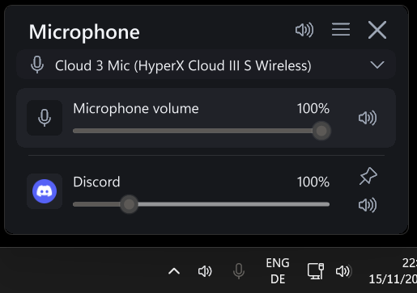

<h1 align="center">Headroom</h1>

A small volume mixer for the Windows tray. 
Per-app volume and output, boost up to 500 %, equalizer, limiter, loudness equalization, 
and sound on <b>two outputs at once</b>.

<a href="CHANGELOG.md">Changelog</a> ·
<a href="#get-it">Get it</a> ·
<a href="#two-outputs-at-once">Two outputs at once</a> ·
<a href="#using-it">Using it</a> ·
<a href="#faq">FAQ</a>

One click on the tray icon opens a clean panel with the master volume and a slider for every app that makes sound.
Send an app to another output, raise it above 100 %, shape its sound, even out the loudness of a game, hear it on
two outputs at once. Nothing is loaded into the apps. It is one small program (under 1 MB) in plain C++ / Win32.

> **`2.1.0-alpha8`, a test version.** Used daily, but young. Every released state is tagged, see the
> [changelog](CHANGELOG.md).

## Get it

1. Download `Headroom-Setup-….exe` from the [releases](https://github.com/jakobtech/headroom/releases) and run it (no
   administrator rights). Or take `Headroom.exe` from the same page, which runs on its own.
2. Install the free [**VB-CABLE**](https://vb-audio.com/Cable/) (donationware). You need it for boost, the
   equalizer, gain, LoudMax, loudness equalization and the second output. The volume, output and mute features work
   without it.
3. *Optional:* [**LoudMax**](https://loudmax.blogspot.com/), a free limiter. Put `LoudMax64.dll` in a VST folder
   (for example `C:\Program Files\VSTPlugins`) or set its path in the settings.

Needs **Windows 11, 64 bit**. The settings have a **Setup guide** that shows what it found on your PC. Use the
official pages above only. Headroom does not include or distribute VB-CABLE or LoudMax.

To remove it, uninstall in Windows *Settings > Apps* (or exit the portable copy and delete it). Settings are in
`%APPDATA%\Headroom\settings.cfg`, the log in `%LOCALAPPDATA%\Headroom\log.txt`.

## What it does

- **Volume** per app and master, mute, mouse wheel, exact entry, keyboard control, pinned apps
- **Output per app**, or move all apps at once
- **Boost** single apps up to **500 %**
- **Two outputs at once**, with a test sound to line them up
- **Equalizer** per app and output: Basic (bass, mids, treble), with *Advanced equalizer* on also 5, 10, 15 bands
- **LoudMax** limiter and **gain** (up to 12 dB) per app or output
- **Loudness equalization** per app, from *Comp* (made for games) to *Long*
- **Surround channels**: a volume for each channel of a 5.1/7.1 game, for example to hear footsteps better
- **Microphone tab**, **volume at startup**, **mute hotkeys**, rename and hide, light/dark theme, **updates** from the settings

<table>
<tr>
<td align="center"> Equalizer</td>
<td align="center"> Effects</td>
<td align="center"> Microphone tab</td>
</tr>
</table>

## Two outputs at once

Hear the same sound on your **speakers and your headset**. Ctrl + right-click the master volume, an app, an output or
a listened-to input, choose **Also play on another output**, and pick the second one. A sync page opens: **Play a test
sound** gives a low tap on the first output and a higher one on the second; move the slider (or the -10, -1, +1, +10 ms
steps) until you hear one tap. Wireless headsets are often 100 to 200 ms behind, so this is what makes it sound right.
The delay stays the same from one start to the next. It needs VB-CABLE and adds about 40 ms to both outputs.

## Using it

| You do | What happens |
|---|---|
| Click / middle-click / scroll the tray icon | Open the mixer / mute / change the master volume |
| Right-click an app | Pick its output |
| **Ctrl + right-click** an app | Menu: output, rename, volume at startup, unlock 500 %, Equalizer, Effects, second output, mute hotkey, hide |
| Right-click / **Ctrl + right-click** the master volume | Pick the playback device / menu with Equalizer, Effects, second output |
| Microphone button in the header | Switch to the microphone tab |
| Click a badge next to a name | Open that panel: `EQ` equalizer, `LM` LoudMax, `LE` loudness, `CH` channels, `S50` startup volume |

Hover the small (i) next to a setting for a short explanation. A mute hotkey is set in the Ctrl + right-click menu of an app.

## FAQ

**Why do I need VB-CABLE?** Windows lets a program record an app only after its volume is applied. To change an app's
sound without a second copy playing, the app is sent to the silent virtual cable first, recorded, processed and played
on the output it is meant for. Measured on one PC this adds about 40 ms; apps without effects play directly with none.
If anything fails, the app is routed back at once.

**Is it safe with anti-cheat?** Headroom never injects code or loads anything into games. It only uses Windows' own
audio interfaces. That is how it is designed to stay clear of anti-cheat, but there is no guarantee for a specific
one, so check the rules of your games.

**Two speaker icons in the tray?** Windows has no setting for hiding its own. The free
[Windhawk](https://windhawk.net/) mod [Taskbar tray system icon tweaks](https://windhawk.net/mods/taskbar-tray-system-icon-tweaks)
can; it is a separate program, and Headroom does not change Explorer itself.

## Building

Plain Win32 / GDI+ / COM in C++23. `build.ps1` builds with an LLVM MinGW toolchain (it uses the compiler that ships
with Windhawk; change the path at the top) and the Windows SDK resource compiler. `build.sh` does the same with MSYS2's
CLANG64 and is what the GitHub workflow uses. Measurement tools for the engine's delay are in `tests/`.

## Credits and license

Copyright (c) Jakob Hüttner. MIT license, see [LICENSE](LICENSE).

Parts of the code derive from the Windhawk mod "Better Volume Mixer" by
[0Allu](https://github.com/0Allu/better-volume-mixer) (MIT, Copyright (c) 2026 Allu).

Headroom is an independent project. It is not affiliated with VB-Audio, LoudMax or Windhawk, and
it is not related to other programs that happen to be called Headroom.
