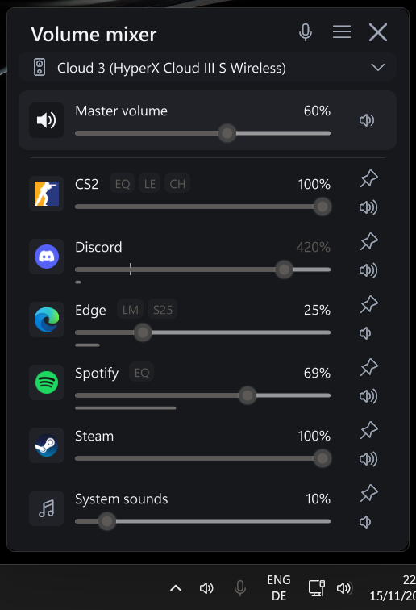
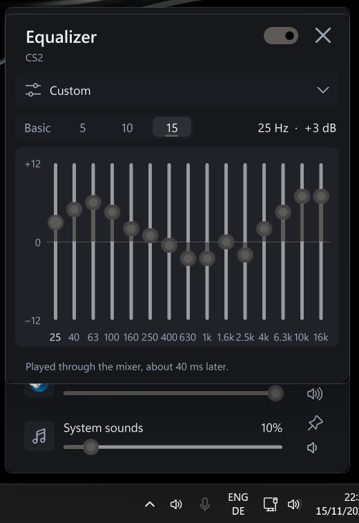
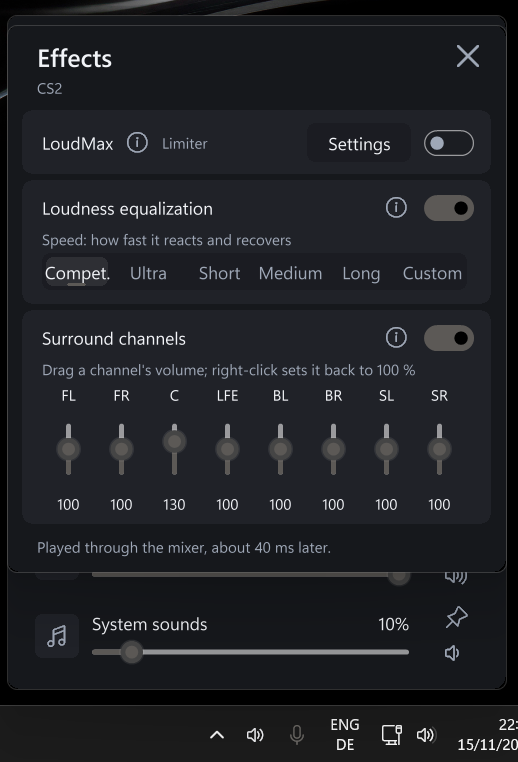
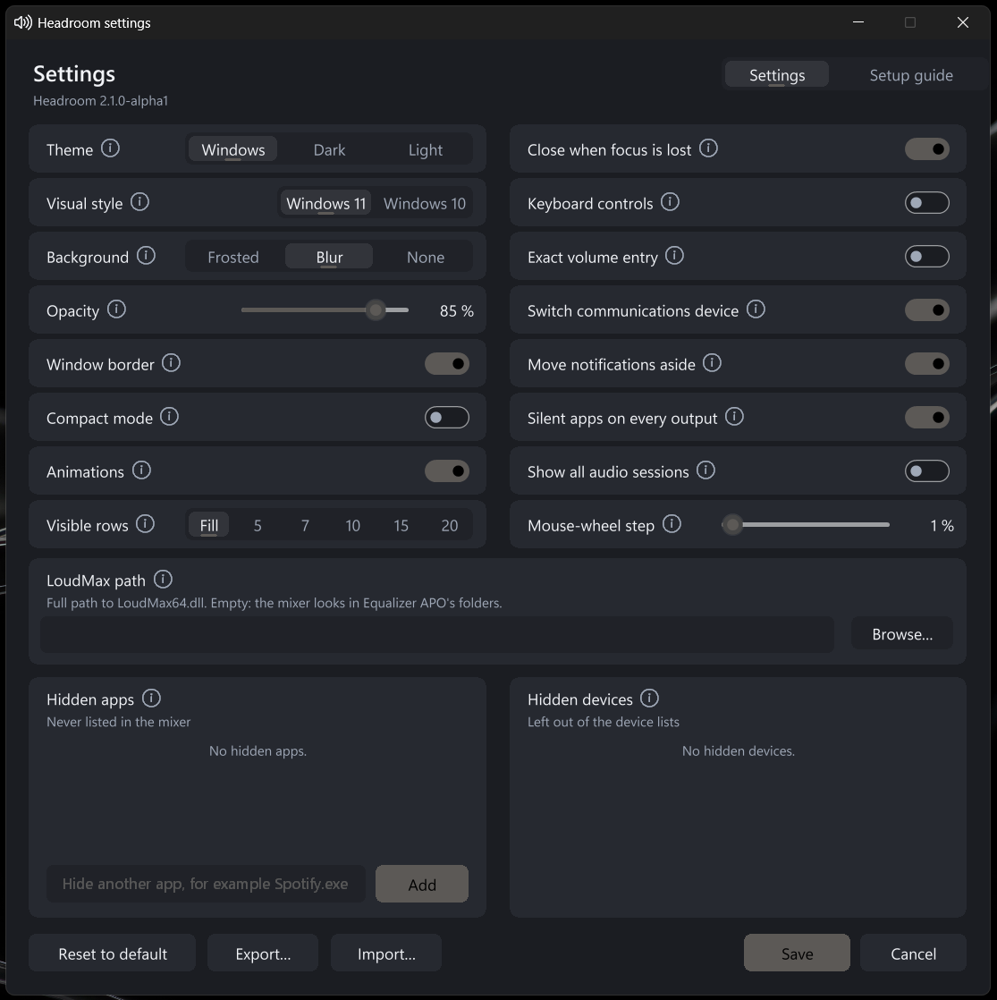

<h1 align="center">Headroom</h1>

A small volume mixer for the Windows tray. 
Per-app volume and output, boost up to 500 %, equalizer, limiter, loudness equalization, microphone tab.

<a href="CHANGELOG.md">Changelog</a> ·
<a href="#quick-start">Quick start</a> ·
<a href="#using-it">Using it</a> ·
<a href="#anti-cheat">Anti-cheat</a> ·
<a href="#faq">FAQ</a>

---

One click on the speaker icon in the tray opens a clean panel with the master volume and a slider for every app
that makes sound. From there you can send an app to another output, raise it above 100 %, shape its sound, tame
loud peaks, or even out the loudness of a game so that shots and explosions stay in check, all without loading
anything into the app.

It is a single small program (under 1 MB, no installer, no framework) written in C++ with plain Win32.

> **Status: `2.1.0-alpha3`, a test version.** It is used daily, but new parts such as the surround channels are
> young. Every released state is tagged, so you can always go back to an earlier one.
> See [CHANGELOG.md](CHANGELOG.md).

## Highlights

| | |
|---|---|
| **Volume** | Master and per-app volume, mute, mouse wheel, exact entry, keyboard control, pinned apps |
| **Output per app** | Send any app to any output (the per-app output Windows Settings uses), or move all apps at once |
| **Boost** | Unlock single apps up to **500 %** |
| **Equalizer** | Per app and per output. Bass/Mids/Treble or 5, 10, 15 bands, presets, your own presets |
| **LoudMax** | Limiter per app and per output (optional, free plugin) |
| **Gain per output** | Raise a quiet output by up to 12 dB, with a limiter behind it |
| **Loudness equalization** | Per app, six speeds from *Comp* (made for games) to *Long*, an expert mode and your own saved settings |
| **Surround channels** | For games that play 5.1/7.1: a volume for each channel (front, center, back, sides, bass), for example to hear footsteps better |
| **Microphone tab** | Default microphone with volume and mute, every input, and the apps that record right now |
| **Volume at startup** | Set an app or a device to a fixed volume whenever it starts |
| **Mute hotkeys** | Per app, also while the mixer is closed and while you play |
| **Updates** | *Check for updates* in the settings: downloads, checks and installs a newer release, then restarts |
| **Tidy** | Rename, hide (for now or for good) apps, devices and System sounds |
| **Look** | Light, dark or Windows theme, Windows 11 or 10 style, blur, compact mode |

Small badges next to a name tell you what is on for that app or output:
`EQ` equalizer, `LM` LoudMax, `LE` loudness equalization, `CH` surround channels, `S50` volume at startup (50 %), `→ Output` fixed to an output.
A click on a badge opens the matching panel.

## Screenshots

<table>
<tr>
<td align="center"> Equalizer, per app and per output</td>
<td align="center"> Effects: loudness and surround channels</td>
<td align="center"> Microphone tab</td>
</tr>
</table>

 
Settings, with reset, export and import

## Requirements

- **Windows 11, 64 bit.** (The per-app effects use Windows' application loopback, which exists from Windows 10
  build 20348.)
- For **boost**, the **equalizer per app**, **LoudMax per app** and **loudness equalization**:
  [**VB-CABLE**](https://vb-audio.com/Cable/), a small free virtual audio output (donationware).
- *Optional:* [**Equalizer APO**](https://sourceforge.net/projects/equalizerapo/) (free, open source) runs the
  equalizer and LoudMax of an **output** without any delay. Without it, the mixer's own engine does the same
  with about 40 ms of delay and leaves system sounds alone. A setting (*Output effects*) picks which one.
- *Optional:* [**LoudMax**](https://loudmax.blogspot.com/) (free, by its author) for the limiter. Put
  `LoudMax64.dll` into Equalizer APO's `VSTPlugins` folder (usually `C:\Program Files\EqualizerAPO\VSTPlugins`)
  or set its path in the settings.

The settings window has a **Setup guide** page with these steps and shows what it found on your PC. Use the
official pages above only: other sites that offer the same downloads may add unwanted software.

Headroom does not include or distribute VB-CABLE, Equalizer APO or LoudMax. You install them yourself from their
own pages and follow their terms.

## Quick start

1. Download `Headroom-Setup-….exe` from the [releases](https://github.com/jakobtech/headroom/releases) and run it
   (no administrator rights needed). Prefer no installer? `Headroom.exe` from the same page runs on its own.
   A speaker icon appears in the tray; drag it out of the overflow menu if you want it visible.
2. Click it to open the mixer. Right-click it for the menu (settings, start with Windows, exit).
3. Install the optional extras above if you want them.

To remove it, uninstall it in Windows *Settings > Apps* (the setup asks whether to keep your settings). With the
portable `Headroom.exe`: exit it from the tray menu, switch off *Start with Windows* in the same menu and delete the
file. Settings live in `%APPDATA%\Headroom\settings.cfg`, the log in
`%LOCALAPPDATA%\Headroom\log.txt`.

## Using it

| You do | What happens |
|---|---|
| Click the tray icon | Open or close the mixer |
| Middle-click the tray icon | Mute the master volume |
| Scroll over the tray icon | Change the master volume |
| Right-click an app | Pick the output for that app |
| Ctrl + right-click an app | Menu: output, rename, volume at startup, unlock up to 500 %, **Equalizer**, **Effects**, mute hotkey, copy process name, hide |
| Right-click the master volume | Pick the playback device (also sets the communications device) |
| Ctrl + right-click the master volume | Output, volume at startup, **Equalizer**, **Effects** for the default output |
| Microphone button in the header | Switch the mixer to the microphone tab (and back) |
| Menu button in the header | List every device with its own volume |
| Ctrl + right-click a device in a list | Hide that device. Bring it back from the tray menu or in the settings |
| Click a badge next to a name | Open that equalizer, the effects, or the startup volume |

**Effects** is its own page: the LoudMax switch (its original window in a frame that matches the mixer) and
loudness equalization. Hover the small (i) next to a setting for a short explanation.

**Equalizer:** drag a band, scroll over it, or right-click it to reset it. Choose *Basic* (bass, mids, treble) or
5, 10 or 15 bands; the curve carries over when you switch.

**Loudness equalization** turns loud sounds down and quiet ones up. *Comp* is made for games: footsteps come
up, shots and explosions are cut within milliseconds, and the output queue is the shortest. *Custom* starts from
any ready-made speed, has eight values and can be saved under a name for other apps.

**Mute hotkeys:** Ctrl + right-click an app, *Set mute hotkey*, press the keys. Esc cancels, Del removes it.
Letters and digits need Ctrl, Alt or Win; F1 to F11, F13 to F24, Pause, Scroll Lock and the media keys also work
alone. Combinations Windows and programs use themselves (Alt+F4, Alt+Tab, Ctrl+C and the like) are refused.

## Anti-cheat

The mixer never injects code into other programs and loads nothing into games. It only uses Windows' own audio
interfaces: the audio session APIs, the per-app output setting that Windows Settings uses, and application
loopback capture. Equalizer APO, if you use it, runs inside Windows' audio service, not inside a game.

That is how it is designed to stay clear of anti-cheat systems. There is no guarantee for a specific one, so
check the rules of the games you play.

## How the effects work

For boost, an app's equalizer, LoudMax and loudness equalization, Windows routes the app to the silent VB-CABLE
output. The mixer records just that app with application loopback, processes the sound and plays it on the output
the app is meant for. Nothing is loaded into the app. If anything fails, the app is routed back at once; when
the mixer exits, every app is routed back.

Measured on one PC, this path adds about 40 ms compared with an app that plays directly. Apps without effects
play directly and have no extra delay. An output's equalizer through Equalizer APO adds practically none.

## FAQ

**Why do I need VB-CABLE?** Windows lets a program record an app only after the app's volume and mute are
applied. To change an app's sound without a second copy playing, the app has to be sent somewhere silent first.
That is what the virtual cable is for.

**What happens to an app's volume above 100 % when I limit it again?** It goes back to 100 %, the most Windows
allows without the unlock.

**Does "Volume at startup" keep the volume locked?** No. An app is set to it once, whenever it starts to play, and
a device whenever the mixer starts or the device comes back. After that the volume is yours.

**Can I use my own LoudMax or another path?** Yes, set its path in the settings.

**There are now two speaker icons in the tray. Can I hide the one from Windows?** Windows has no setting for it
on Windows 11. We recommend the free [Windhawk](https://windhawk.net/) mod
[Taskbar tray system icon tweaks](https://windhawk.net/mods/taskbar-tray-system-icon-tweaks), which can hide
Windows' own volume icon. Headroom itself does not change Explorer or any other program, so this stays your
choice. Windhawk is a separate program.

## Building

The code is plain Win32 / GDI+ / COM in C++23. `build.ps1` builds it with an LLVM MinGW toolchain (the script
uses the compiler that ships with Windhawk; change the path at the top to use your own) and the Windows SDK
resource compiler. `build.sh` does the same with MSYS2's CLANG64 toolchain and is what the GitHub workflow uses.

Measurement tools for the engine's delay are in `tests/`.

## Credits and license

Copyright (c) Jakob Hüttner. MIT license, see [LICENSE](LICENSE).

Parts of the code derive from the Windhawk mod "Better Volume Mixer" by
[0Allu](https://github.com/0Allu/better-volume-mixer) (MIT, Copyright (c) 2026 Allu).

Headroom is an independent project. It is not affiliated with VB-Audio, Equalizer APO, LoudMax or Windhawk, and
it is not related to other programs that happen to be called Headroom.
